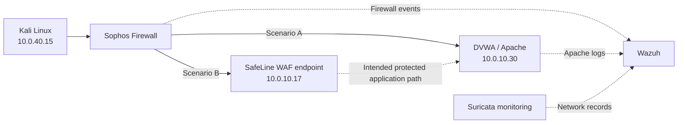
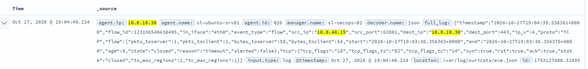
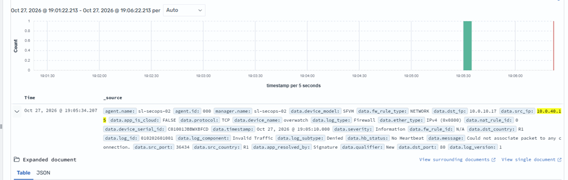
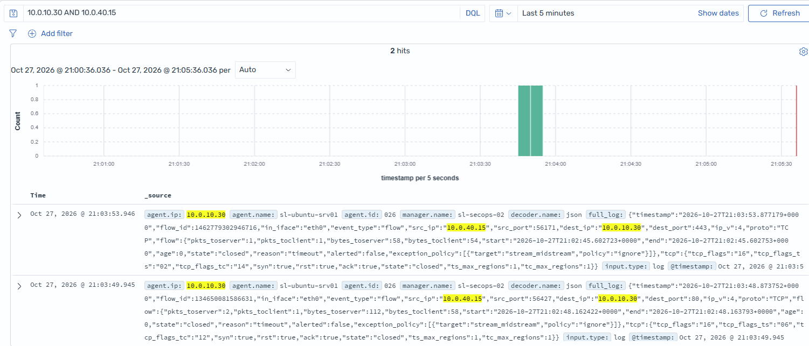
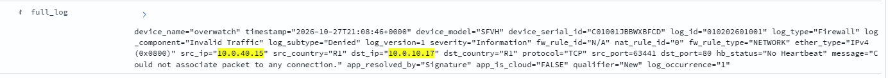

# Network Reconnaissance Investigation with Wazuh, Suricata and Sophos

**Hands-on SOC investigation | Nmap reconnaissance | Network and application logs | WAF comparison**

## Executive summary

This lab examined how security monitoring tools recorded reconnaissance activity against a deliberately vulnerable web application (DVWA). I reviewed six Nmap scanning exercises in two scenarios: direct access through a Sophos firewall, and access to a SafeLine web application firewall (WAF) endpoint in front of DVWA. The investigation used records surfaced in Wazuh, including Suricata network telemetry, Sophos firewall events and Apache web-server access logs.

**Main result:** The collected evidence demonstrates network traffic visibility, Sophos packet-denial events, and—in the direct-to-DVWA scenario—application-layer probes recorded by Apache and surfaced as Wazuh alerts. **The preserved logs do not independently prove that SafeLine blocked the observed requests.**

This repository documents a historical lab exercise using the evidence preserved in my original report. I no longer have access to the live Wazuh dashboard, so I distinguish confirmed observations from interpretations and unverified outcomes.

## Objectives

- Compare observable traffic in a **no-WAF** scenario with traffic addressed to a **WAF endpoint**.
- Examine host discovery, TCP SYN scanning, service detection, HTTP enumeration, aggressive scanning and Nmap vulnerability-script activity.
- Correlate network and web-server events using source/destination IPs, ports, response codes and Wazuh rules.
- Identify what can—and cannot—be concluded from the retained logs.

## Environment and scope

| Component | Role / documented address |
|---|---|
| Kali Linux | Authorized scanning host — `10.0.40.15` |
| DVWA | Deliberately vulnerable web application — `10.0.10.30` |
| SafeLine WAF | WAF endpoint — `10.0.10.17` |
| Sophos Firewall | Network firewall and event source |
| Suricata | Network monitoring / flow records |
| Apache | Web-server access logs on DVWA |
| Wazuh | Centralized event review and alert analysis |
| cloudflared VM | Mentioned in the original scenario overview; exact role/routing not fully documented |

**Scenario A — without WAF:** Kali Linux → Sophos Firewall → DVWA (`10.0.10.30`).

**Scenario B — WAF endpoint:** Kali Linux → Sophos Firewall → SafeLine WAF (`10.0.10.17`) → DVWA (intended application path).

> These are conceptual paths reconstructed from the exercise overview, **not verified packet-by-packet routing diagrams**. The original overview also mentions a cloudflared VM, whose precise placement is not established by the retained evidence.

## Investigation methodology

1. Perform authorized Nmap reconnaissance against the lab target or WAF endpoint.
2. Review the corresponding time window in Wazuh.
3. Inspect available Sophos, Suricata and Apache records.
4. Correlate source/destination addresses, port numbers, HTTP methods, status codes and alert identifiers.
5. Record the observed outcome and note limitations in attribution.

**Command reproducibility:** The original document identifies scan categories but does **not** preserve the exact Nmap command lines or flags. Accordingly, this README does not present reconstructed commands as commands actually executed. Exact commands should only be added if recovered from original notes or terminal history.

## Evidence and findings

### Scan 1 — Host discovery / ping sweep

- **Scenario A:** Suricata recorded traffic involving the Kali and DVWA environment. The preserved event did **not** show a confirmed intrusion-detection alert.
- **Scenario B:** Wazuh displayed a Sophos firewall event involving Kali `10.0.40.15`, WAF endpoint `10.0.10.17`, and TCP port `80`; the firewall denied traffic.
- **Interpretation:** A TCP port-80 event is not, by itself, proof of an ICMP ping-sweep detection. The captured evidence shows traffic visibility and a firewall decision, not a confirmed WAF block.

### Scan 2 — TCP SYN port scan

- **Scenario A:** Suricata flow records included traffic on ports `80` and `443`. The port-80 event aligns with the documented target; the port-443 event requires additional correlation. No explicit Nmap detection alert is shown.
- **Scenario B:** Sophos logged traffic from `10.0.40.15` to `10.0.10.17:80` as **Invalid Traffic / Denied**, with a reason indicating the packet could not be associated with an existing connection.
- **Interpretation:** The log supports a **Sophos firewall denial**, not a proven SafeLine decision. A denied packet does not establish that the whole scan was stopped.

### Scan 3 — Service/version detection and default scripts

- **Scenario A:** Apache recorded an HTTP `GET /evox/about` request carrying an **Nmap Scripting Engine** user-agent. Apache returned **404 Not Found**. Wazuh surfaced **rule `31101`, level `5`**.
- **Scenario B:** A Sophos event for TCP traffic to the WAF endpoint on port `80` was classified as invalid and denied.
- **Interpretation:** The Apache user-agent provides strong evidence that an Nmap application-layer probe reached the web server in Scenario A. The HTTP 404 means the requested resource was absent; it does **not** mean an exploit succeeded. The Scenario B event does not establish WAF-layer inspection or blocking.

### Scan 4 — HTTP enumeration

- **Scenario A:** Apache logged an HTTP `HEAD` request for a Sitecore-related resource, returned **404**, and Wazuh surfaced **rule `31101`, level `5`**.
- **Scenario B:** Sophos logged TCP traffic to `10.0.10.17:80` as invalid and denied.
- **Interpretation:** The direct scenario provides evidence of HTTP enumeration reaching Apache. The WAF scenario has a network-layer denial, but the preserved record is insufficient to attribute it to SafeLine.

### Scan 5 — Aggressive scan

- **Scenario A:** Wazuh showed **69 matching events** in a selected five-minute window. A Sophos event recorded an ICMP error from DVWA toward Kali, **allowed** under a `VLAN-TO-VLAN` rule.
- **Scenario B:** Sophos recorded traffic to destination port `30302` as invalid and denied.
- **Interpretation:** The retained records show network visibility and different firewall outcomes. The 69 matches are **search results**, not necessarily 69 attack detections. The evidence does not establish which aggressive-scan probes triggered alerts.

### Scan 6 — Nmap vulnerability-script scan

- **Scenario A:** Wazuh showed **2,192 matching events** in a five-minute window. One examined Sophos event involved traffic from Kali to port `80` and was classified as invalid and denied.
- **Scenario B:** A Sophos event from Kali was associated with firewall rule `9` and a `VLAN-TO-VLAN` NAT rule. The original notes state traffic was eventually blocked, but the preserved excerpt does not conclusively establish the blocking mechanism or scope.
- **Interpretation:** The event count indicates substantial logged activity, **not 2,192 confirmed vulnerabilities, attacks or alerts**. Specific NSE vulnerability findings cannot be verified without original Nmap output and additional Apache/Suricata evidence.

## Results at a glance

| Test | Scenario A — without WAF | Scenario B — WAF endpoint | Evidence limit |
|---|---|---|---|
| Host discovery | Suricata traffic recorded | Sophos denial on TCP/80 | No confirmed ping-sweep alert |
| TCP SYN scan | Flows on ports 80 and 443 | Sophos invalid/denied on TCP/80 | No proven SafeLine block |
| Service/version + scripts | Nmap user-agent, Apache 404, Wazuh 31101 level 5 | Sophos invalid/denied | No WAF log preserved |
| HTTP enumeration | Apache HEAD 404, Wazuh 31101 level 5 | Sophos invalid/denied | No WAF log preserved |
| Aggressive scan | 69 matching events; ICMP error allowed | Sophos denied traffic to port 30302 | Matches ≠ detections |
| NSE vulnerability scripts | 2,192 matching events; one Sophos denial | Sophos rule/NAT event; later block noted | No verified vulnerability findings |

## Analyst assessment

**Confirmed:**
- Security telemetry from multiple sources was available for investigation in Wazuh.
- Apache logged identifiable Nmap-generated web requests in the direct-to-DVWA scenario.
- Wazuh surfaced at least two HTTP-related events under rule `31101` at level `5`.
- Sophos recorded denied packets in multiple exercises.

**Not confirmed by retained evidence:**
- That SafeLine WAF itself blocked the observed requests.
- That every matching Wazuh record was an alert or an Nmap detection.
- That the Nmap vulnerability-script scan identified exploitable vulnerabilities.
- Exact scan commands, comprehensive packet-level outcomes, or a complete end-to-end timeline.

## Lessons learned

- **Telemetry is not the same as detection.** Flow records show activity, while an alert requires a specific rule or detection condition.
- **Attribution matters.** A Sophos firewall deny event should not be labeled a SafeLine WAF block without SafeLine evidence.
- **HTTP status codes need context.** A 404 response confirms the request reached the web server, not that a vulnerability was exploited.
- **Event counts need careful language.** Dashboard matches can include ordinary flow and firewall records, not just security alerts.
- **Preserving evidence is part of incident response.** Original commands, timestamps, raw log exports and WAF audit logs would strengthen reproducibility and conclusions.

## Future improvements

If the lab becomes available again, I would preserve original Nmap commands/output, export timestamped JSON events, capture SafeLine WAF audit logs, correlate events using common timestamps, and compare equivalent requests across both paths. These are **proposed improvements**, not work claimed as completed.

## Evidence provenance

The source is my four-page **“Incident Response: Nmap Scans in Wazuh (No WAF vs With WAF)”** exercise. The four screenshots extracted from that report are retained in `screenshots/`; they cover the earlier scans. Later scan findings are supported by the written report but do not have additional embedded screenshots in the supplied document.

- [`original-investigation.docx`](original-investigation.docx) — original notes and screenshots.
- [`screenshots/`](screenshots/) — extracted original screenshots.
- `README.md` — recruiter-facing summary and evidence-based interpretation.

**Scope:** Controlled, authorized lab activity only. No real-world targets were tested as part of this documented exercise.
